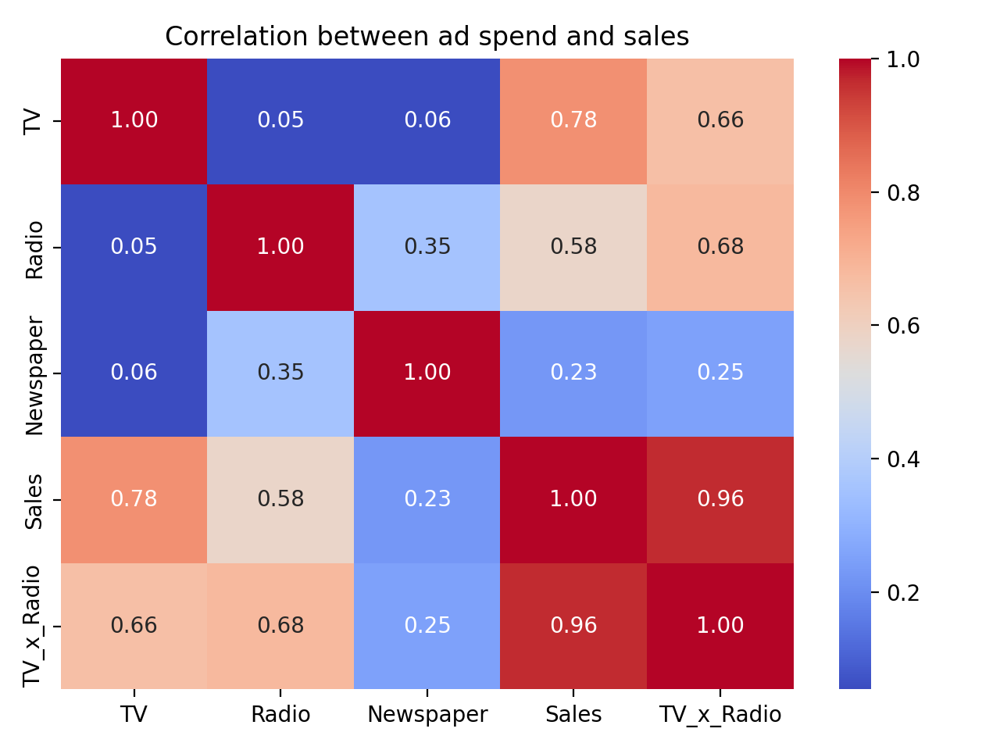
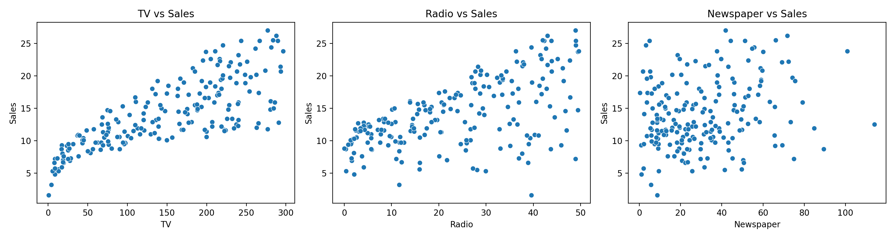

# Sales Prediction using Python

Predicts product sales from advertising spend on TV, Radio and Newspaper,
and analyses which channels drive sales. Built for the CodeAlpha Data
Science Internship (Task 4).

## Dataset
200 records with advertising spend on three channels (TV, Radio, Newspaper)
and the resulting sales. No missing values or duplicates. File:
`Advertising.csv`. Spend and sales units are not stated in the file; they
are commonly treated as thousands of dollars and thousands of units.

## Scope note
The dataset has no time column and no customer-segment column, so this is a
regression analysis, not a time-series forecast. "Platform" refers to the
three advertising channels. "Future sales" means predicted sales for a
planned budget.

## Approach
1. Cleaning: dropped the unnamed index column, checked for missing values
   and duplicates
2. Exploration: correlation heatmap and spend-vs-sales scatter plots
3. Feature selection: tested dropping Newspaper
4. Transformation: created a TV x Radio interaction feature
5. Modelling: linear regression (80/20 split), then 5-fold cross-validation
   comparing four setups

## Results
Linear regression on the held-out test set: R2 = 0.899, MAE = 1.46,
RMSE = 1.78.

5-fold cross-validated R2:

| Model | Mean R2 |
|---|---|
| Linear (TV, Radio, Newspaper) | 0.887 |
| Linear (TV, Radio) | 0.889 |
| Linear + TV x Radio | 0.965 |
| Random Forest | 0.976 |

## Key insights
- TV has the strongest link to sales (correlation about 0.78), Radio is
  moderate (about 0.58) and Newspaper is weak (about 0.23).
- In the linear model, each extra unit of Radio spend is associated with
  about four times the sales of a unit of TV spend (coefficients 0.189
  against 0.045). Newspaper is close to zero (0.003).
- Dropping Newspaper does not reduce accuracy (0.887 to 0.889), so it can
  be removed from the model.
- TV and Radio work better together: adding a TV x Radio feature lifts R2
  from about 0.89 to 0.965.
- Suggested strategy: shift budget from Newspaper towards Radio and TV,
  and run them as combined campaigns.

## Limitations
- The data is observational, so the results show association, not proven
  cause and effect.
- Only 200 rows, and predictions are reliable only within the observed
  spend ranges.
- The simple what-if estimates ignore the TV and Radio interaction, so
  treat them as rough.

## Charts

## Tools
Python, pandas, numpy, scikit-learn, matplotlib, seaborn, Google Colab
